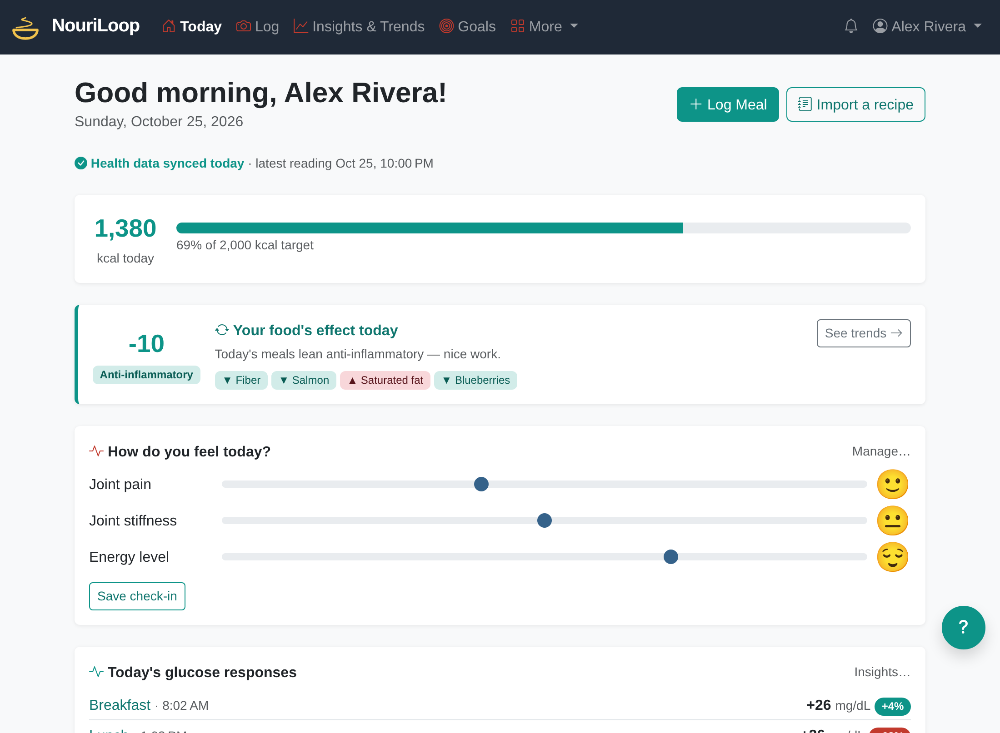

# NouriLoop

[](https://github.com/john-c-houser-tech/nouriloop-app/actions/workflows/ci.yml)
[](LICENSE)

Close the loop between what you eat and how you feel.

NouriLoop is a nutrition tracker built around food photos. You photograph a meal, an AI
model estimates the nutrition and ingredients, and the app connects that over time to your
health metrics (CGM glucose, weight, sleep, and more from Apple Health exports) and to the
symptoms you choose to track.



NouriLoop is an educational wellness tool, not a medical device. Its scores and insights are
not medical advice or diagnosis.

## What it does

- **Photo logging:** photograph a meal, a nutrition label or a recipe; review the estimate,
  answer a question or two, and save. Favorites re-log in one tap.
- **Health data:** import from Apple Health (including Lingo and Stelo glucose sensors),
  CSV or an API token, and see each meal's glucose response.
- **Patterns:** a daily dietary inflammation score, symptom check-ins correlated with what
  you ate (including next-day effects), trends, and supplement suggestions.
- **Goals:** describe a goal in plain words, and the AI turns it into a measurable one with
  scheduled check-ins in the app, by email or by SMS.
- **Six languages:** English, Spanish, German, French, Russian and Hindi.

[FEATURES.md](FEATURES.md) has the full list.

## Three ways to use it

- **Hosted:** sign up at **https://app.nouriloop.com**. Run by NouriLoop LLC, with a free plan.
- **Self-hosted:** run your own copy on a server, with your own name and AI key and no
  billing. [docs/self-hosting.md](docs/self-hosting.md) walks through it: Docker, one
  settings file, about an hour. The AI can be Anthropic, OpenRouter, or your own Ollama
  server.
- **Develop:** run it locally and change it (below).

## Running it locally

You need PHP 8.2 or newer with the `intl` and `imagick` extensions, Composer, MariaDB, and
a mail catcher such as Mailpit on `127.0.0.1:1025`.

```bash
composer install
# .env.local (untracked): APP_SECRET, DATABASE_URL, and optionally ANTHROPIC_API_KEY
php bin/console doctrine:migrations:migrate
php bin/console app:seed-demo-user     # optional: demo@nouriloop.com / demopass123, 60 days of data
symfony serve
```

Without an AI key the app runs, but photo analysis and the other AI features fail. To use
OpenRouter or Ollama instead of Anthropic, see the `AI_PROVIDER` block in `.env`.

Tests: `vendor/bin/phpunit` (unit and functional) and
`vendor/bin/phpunit -c phpunit.e2e.xml.dist` (browser tests). Code style:
`composer cs-check`. [CONTRIBUTING.md](CONTRIBUTING.md) has the test setup.

## Built with

- Symfony 7.4 on PHP, Doctrine ORM, Twig, Bootstrap 5
- MariaDB
- Claude (Anthropic) for photo analysis, goal coaching and the help assistant, or any
  OpenAI-compatible service
- Stripe for subscriptions and Twilio for SMS, on the hosted service

## Where to read next

- [CONTRIBUTING.md](CONTRIBUTING.md): how to propose a change
- [CHANGELOG.md](CHANGELOG.md): what changed in each release
- `CLAUDE.md`: the developer notes that apply everywhere, with a map to `.claude/rules/`,
  which holds the detail for each area (written for both people and coding agents)
- `CONTEXT.md` and `docs/adr/`: domain glossary and architecture decisions
- [SECURITY.md](SECURITY.md): how to report a vulnerability

## License

Copyright © 2026 NouriLoop LLC. The source code is licensed under the
[GNU Affero General Public License v3.0](LICENSE) or later. If you run a modified version
as a network service, the AGPL requires you to offer your users its source.

The NouriLoop name, logo, and other brand assets are trademarks of NouriLoop LLC and are not
covered by the license. A fork must use its own name and branding.
